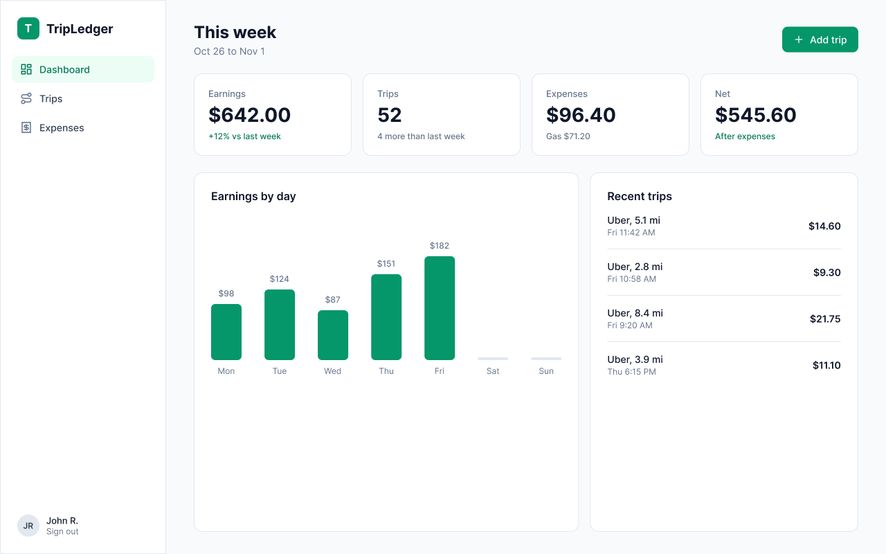

# TripLedger

A ledger for ride-share drivers. Log trips (Uber, Lyft or direct: fare, tip, distance) and expenses (gas, maintenance, tolls, other), then see earnings, expenses and net for the week.



## Stack

| Part     | Tech                                                                |
| -------- | ------------------------------------------------------------------- |
| Backend  | Python 3.14, FastAPI, SQLModel, PyJWT, pwdlib (Argon2)              |
| Database | Postgres on Neon (production), SQLite for local dev and tests       |
| Frontend | React 19, TypeScript, Vite, Tailwind CSS v4, React Router v8        |
| Tooling  | pytest + httpx (API tests), pyright (types), oxlint (frontend lint) |

## Project layout

```text
tripledger/
├── backend/            FastAPI app
│   ├── app/
│   │   ├── main.py     app, CORS, router mounting, /health
│   │   ├── models.py   SQLModel tables and request/response models
│   │   ├── database.py engine and per-request session
│   │   ├── security.py password hashing and JWTs
│   │   ├── deps.py     SessionDep and CurrentUser dependencies
│   │   └── routers/    auth, trips, expenses, summary
│   └── tests/          API tests (in-memory SQLite)
├── frontend/           React app
│   └── src/
│       ├── pages/      Login, Dashboard, Trips, AddTrip, Expenses
│       ├── components/ Layout (sidebar shell) and shared UI pieces
│       ├── api.ts      fetch wrapper (JWT, errors, 401 handling)
│       └── types.ts    TypeScript mirrors of the API models
└── design/             PNG exports of the Figma screens
```

## Getting started

You need Python 3.14 and Node.js.

### Backend

```bash
cd backend
python3 -m venv .venv
source .venv/bin/activate
pip install -r requirements-dev.txt
```

`requirements-dev.txt` is a lock file: every package, including the ones your dependencies pull in, is pinned to an exact version with a hash, so pip refuses anything that doesn't match. See [Dependencies](#dependencies) to add or upgrade one.

Create `backend/.env` with a secret for signing tokens:

```bash
echo "SECRET_KEY=$(openssl rand -hex 32)" > .env
```

| Variable       | Required | What it does                                                                               |
| -------------- | -------- | ------------------------------------------------------------------------------------------ |
| `SECRET_KEY`   | Yes      | Signs login tokens. At least 32 characters; the app refuses to start without it.           |
| `DATABASE_URL` | No       | Postgres connection string (e.g. from Neon). Without it, the app uses a local SQLite file. |

Start the dev server:

```bash
fastapi dev app/main.py
```

The API runs on <http://127.0.0.1:8000>, with interactive docs at <http://127.0.0.1:8000/docs>. The tables are created on first start, in the SQLite file (`backend/tripledger.db`) or in Postgres.

### Frontend

In a second terminal:

```bash
cd frontend
npm install
npm run dev
```

Open <http://localhost:5173>. The app calls the API at `http://127.0.0.1:8000` by default; set `VITE_API_URL` to point it elsewhere.

## Scripts

| Where       | Command             | What it does                            |
| ----------- | ------------------- | --------------------------------------- |
| `backend/`  | `pytest`            | Runs the API tests                      |
| repo root   | `npx pyright`       | Type-checks the backend                 |
| `frontend/` | `npm run build`     | Type-checks and builds for production   |
| `frontend/` | `npm run typecheck` | Type-checks only (`tsc -b`), used by CI |
| `frontend/` | `npm run lint`      | Lints with oxlint                       |

## Dependencies

The backend's dependencies are listed in two files you edit, and two lock files generated from them:

| File                   | Edit it? | Contents                                                      |
| ---------------------- | -------- | ------------------------------------------------------------- |
| `requirements.in`      | Yes      | Packages the app uses, pinned with `==`                       |
| `requirements-dev.in`  | Yes      | Test tools (pytest, httpx), on top of `requirements.in`       |
| `requirements.txt`     | No       | Lock file for the Docker image: every package, with hashes    |
| `requirements-dev.txt` | No       | Lock file for local dev and CI: the same, plus the test tools |

To add or upgrade a package, change its line in a `.in` file, then regenerate both lock files from `backend/` (needs [uv](https://docs.astral.sh/uv/)) and reinstall:

```bash
uv pip compile requirements.in --universal --python-version 3.14 --generate-hashes -o requirements.txt
uv pip compile requirements-dev.in --universal --python-version 3.14 --generate-hashes -o requirements-dev.txt
pip install -r requirements-dev.txt
```

The Docker build and CI install with `--require-hashes --only-binary :all:`: only the exact files in the lock, and only prebuilt wheels, so no package runs setup code during install.

## API

Every route except register, login and `/health` needs an `Authorization: Bearer <token>` header. Users only ever see their own trips and expenses; another user's record returns 404.

| Method | Path             | Notes                                                                     |
| ------ | ---------------- | ------------------------------------------------------------------------- |
| POST   | `/auth/register` | JSON body: email, password                                                |
| POST   | `/auth/login`    | Form data (`username` = email, `password`); returns a JWT                 |
| GET    | `/auth/me`       | The logged-in user                                                        |
| GET    | `/trips`         | Filters: `platform`, `start`, `end`; paging: `limit`, `offset`            |
| POST   | `/trips`         | Create a trip                                                             |
| GET    | `/trips/{id}`    | One trip                                                                  |
| PATCH  | `/trips/{id}`    | Partial update                                                            |
| DELETE | `/trips/{id}`    | Delete a trip                                                             |
| GET    | `/expenses`      | Filters: `category`, `start`, `end`                                       |
| POST   | `/expenses`      | Create an expense                                                         |
| DELETE | `/expenses/{id}` | Delete an expense                                                         |
| GET    | `/summary`       | Earnings, expenses and net for `start`–`end` (default: this Mon–Sun week) |
| GET    | `/health`        | Health check                                                              |

## Deployment

The app is set up to run on a k3s server at <https://tripledger.codewithxjohn.com> (not live yet). Both parts are served from one domain: the Traefik Ingress sends `/api/*` to FastAPI and everything else to the React app.

| File                           | What it does                                                                                                                   |
| ------------------------------ | ------------------------------------------------------------------------------------------------------------------------------ |
| `backend/Dockerfile`           | Python 3.14 image running uvicorn with `--root-path /api`, as a non-root user                                                  |
| `frontend/Dockerfile`          | Builds the app with `VITE_API_URL=/api`, then serves `dist/` with nginx (`nginx.conf`)                                         |
| `kubernetes/`                  | Deployments (non-root, read-only filesystem), Services, Ingress, a Traefik middleware that strips `/api`, cert-manager issuers |
| `.github/workflows/deploy.yml` | Tests and scans every PR; on `main`, builds and pushes the images, then deploys after approval                                 |
| `.github/dependabot.yml`       | Monthly PRs that update the pinned GitHub Actions, Docker base images and npm packages                                         |

To build the images locally:

```bash
docker build -t tripledger-backend backend
docker build -t tripledger-frontend frontend
```

## Design

The screens were designed in Figma: [TripLedger screens](https://www.figma.com/design/g6y4sGSmMhx6spHVd7tx4P). PNG exports of all five (login, dashboard, trips, add trip, expenses) are in [`design/`](design/).

## Notes

- There are no database migrations yet. After changing a table in `models.py`, delete `backend/tripledger.db` and restart the server to recreate it.
- When a model in `models.py` changes, update `frontend/src/types.ts` to match.
